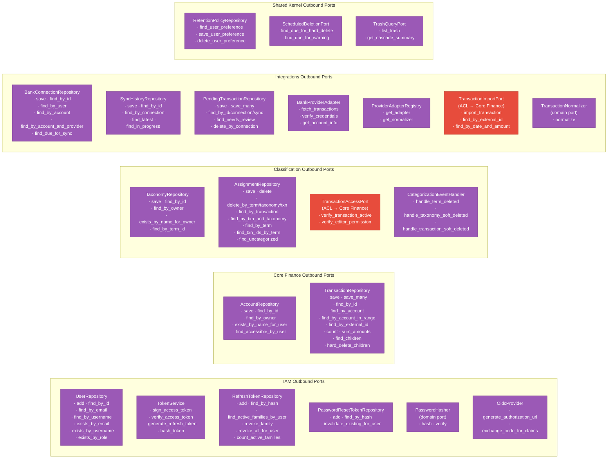
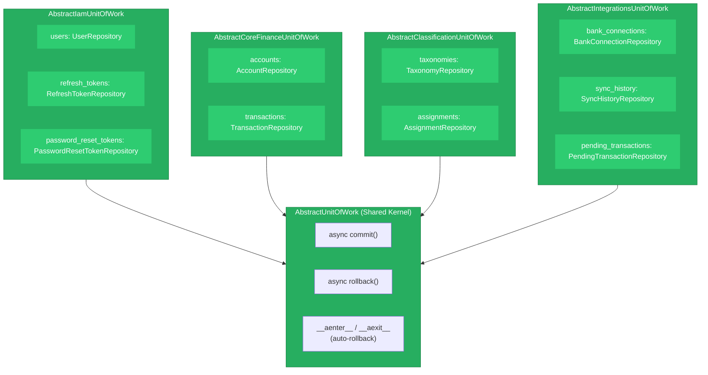
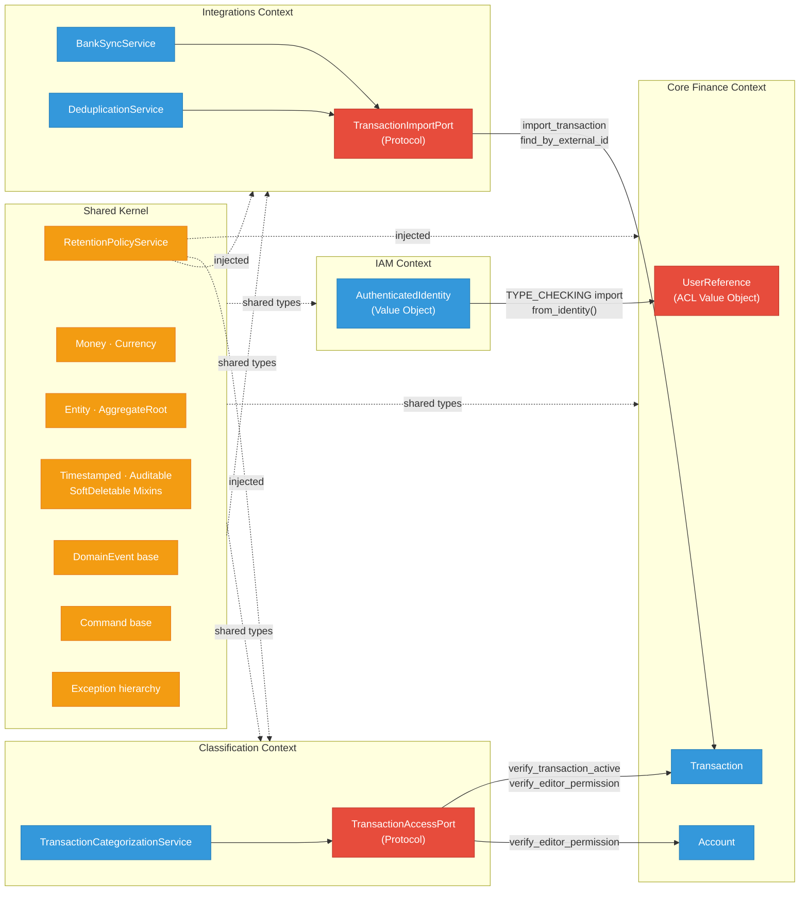

# Emerald Backend — Ports & Adapters Architecture

## Full System Overview

```mermaid
graph TB
    subgraph INFRA["🔧 Infrastructure Layer (not yet implemented)"]
        direction TB
        DB[(PostgreSQL)]
        JWT[JWT Library]
        OIDC_EXT[Google/Microsoft OIDC]
        BANK_EXT[Bank APIs]
    end

    subgraph APP["Application Layer"]
        direction TB

        subgraph IAM_APP["IAM Services"]
            URS[UserRegistrationService]
            AUS[AuthenticationService]
            RMS[RoleManagementService]
            SPS[SuperadminProvisioningService]
        end

        subgraph CF_APP["Core Finance Services"]
            AMS[AccountManagementService]
            ASS[AccountSharingService]
            TMS[TransactionManagementService]
            TBMS[TransactionBulkManagementService]
            CMS[CardManagementService]
        end

        subgraph CL_APP["Classification Services"]
            TXMS[TaxonomyManagementService]
            TCS[TransactionCategorizationService]
        end

        subgraph INT_APP["Integrations Services"]
            BCS[BankConnectionService]
            BSS[BankSyncService]
            DDS[DeduplicationService]
        end
    end

    subgraph DOMAIN["Domain Layer"]
        direction TB

        subgraph SK_DOMAIN["Shared Kernel"]
            RPS[RetentionPolicyService]
            SK_BASE["Entity / AggregateRoot\nTimestamped / Auditable\nSoftDeletable Mixins"]
            SK_VO["Money · Currency\nRetentionPeriod · DateRange\nPaginatedResult · TrashItem\nDeletableEntityType"]
        end

        subgraph IAM_DOMAIN["IAM Domain"]
            USER["👤 User\n(AggregateRoot)"]
            RT["RefreshToken\n(Entity)"]
            PRT["PasswordResetToken\n(Entity)"]
            IAM_VO["EmailAddress · Username\nHashedPassword · AuthProvider\nSystemRole · AdminPermission\nAccessTokenClaims\nAuthenticatedIdentity\nOidcClaims · UserPreferences"]
            PV["password_validation\n(domain service)"]
        end

        subgraph CF_DOMAIN["Core Finance Domain"]
            ACCOUNT["🏦 Account\n(AggregateRoot)"]
            SHARE["AccountShare\n(child Entity)"]
            CARD["Card\n(child Entity)"]
            TXN["💳 Transaction\n(AggregateRoot)"]
            CF_VO["AccountName · IBAN\nPermissionLevel · UserReference\nImportSource · ReviewStatus\nSplitRequest · CardNumber\nCardType · CardNetwork\nBulkResult · TransactionInput"]
        end

        subgraph CL_DOMAIN["Classification Domain"]
            TAXONOMY["📂 Taxonomy\n(AggregateRoot)"]
            TERM["TaxonomyTerm\n(child Entity)"]
            ASSIGN["TransactionTermAssignment\n(Entity)"]
            CL_VO["TaxonomyName · TermName\nTaxonomyPath"]
        end

        subgraph INT_DOMAIN["Integrations Domain"]
            BANKCONN["🔗 BankConnection\n(AggregateRoot)"]
            PENDING["PendingTransaction\n(Entity)"]
            SYNCH["SyncHistory\n(Entity)"]
            INT_VO["ProviderName · ProviderCredentials\nConnectionStatus · NormalizedTransaction\nMatchStatus · DeduplicationResult\nSyncResult · SyncStatus"]
        end
    end

    %% Domain composition
    USER --> RT
    USER --> PRT
    ACCOUNT --> SHARE
    ACCOUNT --> CARD
    TXN -.->|parent/child split| TXN
    TAXONOMY --> TERM
    BANKCONN --> PENDING
    BANKCONN --> SYNCH
    ASSIGN -.->|cross-context link| TXN
    ASSIGN -.->|cross-context link| TERM

    %% Services → Domain
    URS --> USER
    AUS --> USER
    AUS --> RT
    AUS --> PRT
    RMS --> USER
    SPS --> USER
    AMS --> ACCOUNT
    ASS --> ACCOUNT
    TMS --> TXN
    TBMS --> TXN
    CMS --> ACCOUNT
    TXMS --> TAXONOMY
    TCS --> ASSIGN
    BCS --> BANKCONN
    BSS --> BANKCONN
    BSS --> SYNCH
    BSS --> PENDING
    DDS -.-> BSS

    %% Shared Kernel injection
    RPS -.->|injected into| AMS
    RPS -.->|injected into| TMS
    RPS -.->|injected into| TBMS
    RPS -.->|injected into| CMS
    RPS -.->|injected into| TXMS
    RPS -.->|injected into| BCS

    classDef aggregate fill:#4a90d9,stroke:#2c5f8a,color:white
    classDef entity fill:#7fb3d8,stroke:#4a90d9,color:white
    classDef vo fill:#b8d4e8,stroke:#7fb3d8,color:#333
    classDef service fill:#f5a623,stroke:#d4891a,color:white
    classDef domainService fill:#e8c547,stroke:#c4a636,color:#333
    classDef infra fill:#888,stroke:#555,color:white

    class USER,ACCOUNT,TXN,TAXONOMY,BANKCONN aggregate
    class RT,PRT,SHARE,CARD,TERM,ASSIGN,PENDING,SYNCH entity
    class SK_VO,IAM_VO,CF_VO,CL_VO,INT_VO vo
    class URS,AUS,RMS,SPS,AMS,ASS,TMS,TBMS,CMS,TXMS,TCS,BCS,BSS,DDS service
    class RPS,PV,SK_BASE domainService
    class DB,JWT,OIDC_EXT,BANK_EXT infra
```

---

## Ports & Adapters (Hexagonal) — Port Contracts

---

## Unit of Work Composition

---

## Cross-Context Boundaries (Anti-Corruption Layer)

---

## Service Dependency Graph

```mermaid
graph TD
    subgraph IAM_SVC["IAM Application Services"]
        URS2["UserRegistrationService"]
        AUS2["AuthenticationService"]
        RMS2["RoleManagementService"]
        SPS2["SuperadminProvisioningService"]
    end

    subgraph CF_SVC["Core Finance Application Services"]
        AMS2["AccountManagementService"]
        ASS2["AccountSharingService"]
        TMS2["TransactionManagementService"]
        TBMS2["TransactionBulkManagementService"]
        CMS2["CardManagementService"]
    end

    subgraph CL_SVC["Classification Application Services"]
        TXMS2["TaxonomyManagementService"]
        TCS3["TransactionCategorizationService"]
    end

    subgraph INT_SVC["Integrations Application Services"]
        BCS2["BankConnectionService"]
        BSS3["BankSyncService"]
        DDS3["DeduplicationService"]
    end

    %% IAM dependencies
    URS2 -->|"uow"| UOW_I["AbstractIamUnitOfWork"]
    URS2 -->|"hasher"| PH["PasswordHasher"]
    AUS2 -->|"uow"| UOW_I
    AUS2 -->|"hasher"| PH
    AUS2 -->|"token_service"| TS["TokenService"]
    AUS2 -.->|"oidc_provider?"| OP["OidcProvider"]
    RMS2 -->|"uow"| UOW_I
    SPS2 -->|"uow"| UOW_I
    SPS2 -->|"hasher"| PH

    %% Core Finance dependencies
    AMS2 -->|"uow"| UOW_C["AbstractCoreFinanceUnitOfWork"]
    AMS2 -->|"retention"| RPS3["RetentionPolicyService"]
    ASS2 -->|"uow"| UOW_C
    TMS2 -->|"uow"| UOW_C
    TMS2 -->|"retention"| RPS3
    TBMS2 -->|"uow"| UOW_C
    TBMS2 -->|"retention"| RPS3
    CMS2 -->|"uow"| UOW_C
    CMS2 -->|"retention"| RPS3

    %% Classification dependencies
    TXMS2 -->|"uow"| UOW_CL2["AbstractClassificationUnitOfWork"]
    TXMS2 -->|"retention"| RPS3
    TCS3 -->|"uow"| UOW_CL2
    TCS3 -->|"acl"| TAP2["TransactionAccessPort"]

    %% Integrations dependencies
    BCS2 -->|"uow"| UOW_INT2["AbstractIntegrationsUnitOfWork"]
    BCS2 -->|"retention"| RPS3
    BSS3 -->|"uow"| UOW_INT2
    BSS3 -->|"acl"| TIP3["TransactionImportPort"]
    BSS3 -->|"registry"| BPAR["ProviderAdapterRegistry"]
    DDS3 -->|"acl"| TIP3

    %% RetentionPolicyService dependency
    RPS3 -->|"repo"| RPR["RetentionPolicyRepository"]

    classDef svc fill:#f5a623,stroke:#d4891a,color:white
    classDef uow fill:#27ae60,stroke:#1e8449,color:white
    classDef port fill:#9b59b6,stroke:#7d3c98,color:white
    classDef acl fill:#e74c3c,stroke:#c0392b,color:white
    classDef dSvc fill:#e8c547,stroke:#c4a636,color:#333

    class URS2,AUS2,RMS2,SPS2,AMS2,ASS2,TMS2,TBMS2,CMS2,TXMS2,TCS3,BCS2,BSS3,DDS3 svc
    class UOW_I,UOW_C,UOW_CL2,UOW_INT2 uow
    class PH,TS,OP,RPR,BPAR port
    class TAP2,TIP3 acl
    class RPS3 dSvc
```

---

## Legend

| Color | Meaning |
|-------|---------|
| 🔵 Blue | Aggregate Roots |
| 🔵 Light Blue | Child Entities |
| 🟠 Orange | Application Services |
| 🟡 Yellow | Domain Services |
| 🟣 Purple | Protocol Ports (outbound) |
| 🔴 Red | ACL / Anti-Corruption Layer Ports |
| 🟢 Green | Unit of Work abstractions |
| ⬜ Gray | Infrastructure (not yet implemented) |

## Key Architectural Principles

1. **All ports are `typing.Protocol`** — structural subtyping, no ABC inheritance
2. **All port methods are `async def`** — prepared for async infrastructure
3. **No cross-context domain imports at runtime** — only via ACL ports or `TYPE_CHECKING` guards
4. **Shared Kernel provides base types** — Entity, AggregateRoot, mixins, Money, exceptions, events
5. **Events born only inside aggregates** — via `_register_event()`, collected via `collect_events()`
6. **Each UoW composes its context's repositories** — services receive UoW, not individual repos
7. **RetentionPolicyService is the only shared domain service** — injected across all contexts that do soft-delete
